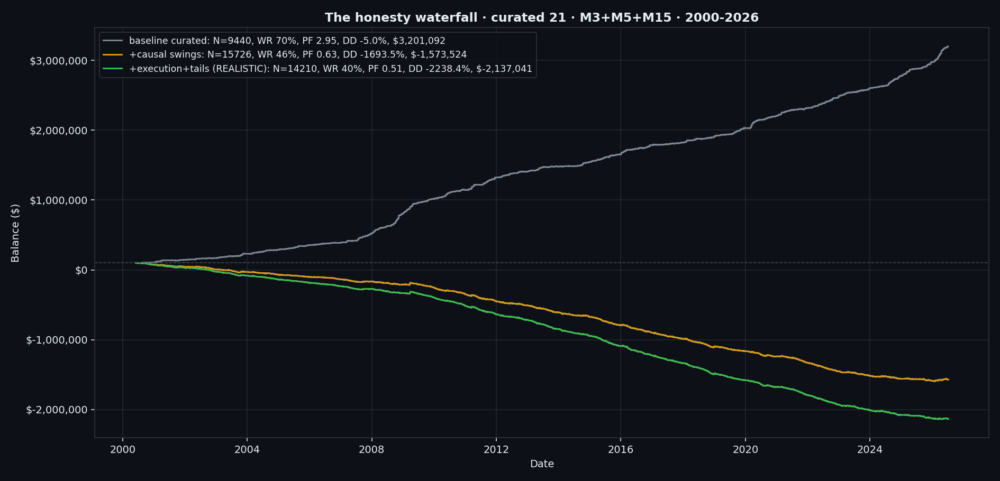

# SwiftPip: systematic trading research in Python and MetaTrader 5

SwiftPip is my own research platform for rule-based trading strategies. It started while I was a software
engineer at UFX, where I coded and backtested FX and index strategies, and I have carried it on by myself since.
This repository holds the backtests, the analysis scripts and a live MetaTrader 5 bot for the strategies I
tested between 2024 and 2026.

The headline result is a negative one. The best strategy looked excellent in its first backtest and turned out
to be an artefact of look-ahead bias. This README is mostly about how that was found and what the strategy is
really worth.

<p align="center">
  
</p>

## At a glance

- **The claim.** An EMA 7/18 crossover with a fair value gap (FVG) entry and a draw-on-liquidity (DOL) target,
  run on 21 curated instruments across three timeframes (M3, M5, M15) from 2000 to 2026, showed 9,440 trades,
  a 69.5% win rate, a profit factor of 2.95 and a maximum drawdown of 5.0%.
- **The bug.** A swing high or low needs five bars on each side before it exists. The backtest used each swing
  from the bar where it formed, for both the stop-loss anchor and the "DOL at least 2R away" filter that
  decides which trades are taken. The live bot could never see those swings in time.
- **The honest number.** With swings usable only once confirmed, the profit factor fell to 0.63. Adding missed
  fills, polling lag, spread widening, stop slippage and rare gaps through the stop took it to **0.51** on
  14,210 trades. On all 40 instruments, with no curation, it was 0.44.
- **Curation did not survive either.** Picking instruments on 2000-2013 only (profit factor at least 2 and at
  least 30 trades) selected none of them once swings were causal, so there was nothing left to test on
  2014-2026.
- **Outcome.** I dropped the strategy. The check that caught it (only use information that existed at the
  time) is now the first thing every model in my other projects has to pass.

## Contents

[The strategies](#the-strategies) · [The look-ahead bug](#the-look-ahead-bug) ·
[The realistic backtest](#the-realistic-backtest) · [Other findings](#other-findings) ·
[The live bot](#the-live-bot) · [Limitations](#limitations) · [Run it](#run-it) · [Layout](#layout)

## The strategies

Every strategy is mechanical: entries, stops and targets are defined in code, trades are simulated bar by bar,
and on each bar the stop is checked before the target, so a bar that touches both counts as a loss. Results are
expressed in R (multiples of the amount risked), with 1% of the account risked per trade unless stated.

The families tested, each in its own script:

| Family | Idea | Main script |
|---|---|---|
| EMA crossover + FVG + DOL | Trend entry on an EMA cross, entered on the retest of the first aligned FVG, targeting the next pool of liquidity | `ema_dol_strategy.py`, `realistic_ema_dol_rsi.py`, `causal_realistic.py` |
| Liquidity sweep + inverse FVG | Previous 4-hour high or low swept, then a 15-minute FVG inverted | `sweep_15m_ifvg.py`, `sweep_mss_ifvg.py`, `confluence_sweep.py` |
| Asia range sweep | Asia session range swept in London, confirmed by CISD or IFVG | `asia_london.py`, `asia_1m_cisd.py`, `asia_all_pairs.py`, `asia_bot/` |
| Silver Bullet | Session-window sweep, FVG and retest | `silver_bullet.py` |
| 4-hour swing displacement | Sweep of a 4-hour swing with the stop at the displacement candle | `h4_swing_displacement.py` |
| CISD | Change in state of delivery after a daily high or low sweep | `cisd_strategy.py`, `cisd_dev.py` |
| Candle range theory | 4-hour range sweep and close back inside | `crt_hunt.py`, `crt_5m_entry.py` |
| Power of three | Daily accumulation, manipulation, distribution | `powell_po3.py`, `powell_po3_fib.py` |
| Opening range breakout | Breakout of the first range of the session | `orb_hunt.py` |
| Mean reversion | Bollinger Band and RSI reversal | `mean_reversion.py`, `bb_rsi_backtest.py` |
| Futures trend | Slow trend following across a futures basket | `futures_trend.py` |

`master_compare.py` runs the early families through one harness and writes a leaderboard. That leaderboard and
my early notes are kept in [`docs/early-leaderboard.txt`](docs/early-leaderboard.txt) and
[`docs/early-notes.md`](docs/early-notes.md) as a record. **They predate the look-ahead fix and overstate every
swing-based strategy.** The same applies to the figures quoted in the docstrings of some scripts and of
`live/config.py`, which I have left as written so the history is visible.

## The look-ahead bug

`find_swings_arr` in `ema_dol_strategy.py` marks bar *j* as a swing high when its high is above the highs of the
five bars on either side (`SWING_LOOKBACK = 5`). That is a fine definition, but it means the swing can only be
known at bar *j* + 5. The original backtest stored swings by the bar they formed on and then searched them up to
the entry bar, so a trade at bar *j* + 2 could already "see" a swing that needed three more bars to be
confirmed.

The swings were used twice, which is why the effect was so large:

1. **Stop placement.** The stop sat beyond the most recent swing. A swing that had not formed yet is, by
   construction, a level that price then respected, so stops were placed with hindsight.
2. **Trade selection.** A trade was only taken if the next swing in its direction (the draw on liquidity) was at
   least 2R away. Using unconfirmed swings let the filter pick trades whose target was already known to be far
   away, which is a large part of why the win rate was 69.5%.

The fix in `causal_realistic.py` (`run_causal`) only allows a swing formed at index *j* to be used from bar
*j* + 5 onward, for both the stop and the filter. That is exactly what the live detector does. It changes which
trades exist, not just their outcomes: the trade count rose from 9,440 to 15,726 because the filter no longer
rejects trades using information from the future.

## The realistic backtest

`causal_realistic.py` applies five corrections in turn, on the same 2000-2026 data (HistData one-minute bars
resampled, joined to the MetaTrader 5 broker feed for recent years), with per-instrument spreads on every fill:

| Factor | What it models |
|---|---|
| F1 Causal swings | Swings usable only once confirmed, for the stop and the selection filter |
| F2 Selection | Results for the curated 21 instruments and for all 40, plus walk-forward curation (picked on 2000-2013, tested on 2014-2026) |
| F3 Execution | 10% of entries missed; polling lag of 0.3 spreads on every fill; 15% of trades pay 2.5 times the spread; stop slippage of 0.5 spreads |
| F4 Prop-firm rules | Daily and overall loss limits simulated on the capped trade stream |
| F5 Tails | 0.2% of trades (one or two a year) gap through the stop and lose 3R |

Results from [`docs/realistic_run.log`](docs/realistic_run.log), $100k starting balance and a fixed $1,000
(1%) risked per trade:

| Stream | Trades | Per day | Win rate | Profit factor | Total R | Longest losing streak |
|---|---:|---:|---:|---:|---:|---:|
| 1. Baseline, curated 21 | 9,440 | 1.39 | 69.5% | 2.95 | +3,101 | 8 |
| 2. + causal swings | 15,726 | 2.31 | 45.8% | 0.63 | -1,674 | 16 |
| 3. + execution and tails | 14,210 | 2.09 | 40.1% | 0.51 | -2,237 | 26 |
| 4. Same, all 40 instruments | 23,847 | 3.50 | 37.3% | 0.44 | -4,485 | 20 |

The balances fall below zero because the run risks a fixed $1,000 per trade and keeps trading after the
account would have been wiped out; it shows the size of the loss, not a tradable path. The walk-forward step
found no instrument that met the curation rule on 2000-2013, and the script stops there with an error when it
tries to report an empty basket, which is visible at the end of the log.

Two things made the baseline look trustworthy, and both were misleading. It was profitable in all 27 years,
and it held up on a second data source (HistData against the broker feed). Neither check can catch look-ahead
bias, because the bias is in the code, not in the data, so it is present in every year and on every feed.

## Other findings

These come from the scripts and figures in this repository. Each was measured before the look-ahead fix unless
it is a non-swing strategy, so treat the swing-based ones as optimistic.

- **Fixed targets against managed exits.** `test_fixed_rr.py`, `test_cross_exit.py` and
  `test_gradient_exit.py` compare a fixed 2R or 3R target, an exit on the opposite EMA cross, and a "gradient"
  exit when the fast EMA's slope turns against the trade
  ([figure](docs/figures/ema718_final_exit_fixed_vs_gradient.png)).
- **Spread sensitivity.** `spread_analysis.py` widens the stop by the live spread plus one pip. On 2022-2026 this
  cut the M15 stream from 383 to 278 trades and the final balance from $543K to $319K. Both streams stayed
  profitable, but these runs predate the causal fix
  ([figure](docs/figures/spread_analysis_equity_before_after.png)).
- **Naive against realistic fills** for the Asia-sweep CISD strategy on one-minute data
  ([figure](docs/figures/realistic_1m_cisd_equity_naive_vs_realistic.png)).
- **Losing streaks.** `combined_streak_deep.py` and `worst_periods.py` look at the length and timing of losing
  runs, which matter more than the average for a prop-firm account with a hard drawdown limit
  ([figure](docs/figures/top3_optionA_loss_streak_histogram.png)).
- **Breakeven and partial exits.** `analyze_be.py` and `eurusd_basic.py` test moving the stop to breakeven or
  taking half off at 1R.

## The live bot

Two bots run against MetaTrader 5 through the official `MetaTrader5` Python package, on a demo account. Neither
contains any login: they attach to whatever account the MetaTrader 5 terminal is already logged into.

- `live/` runs the EMA + FVG + DOL strategy on three timeframes, one engine per timeframe with its own magic
  number. `detector_ema_dol.py` uses swings only once confirmed. `parity_test.py` checks that the detector finds
  the same setups as the backtest on historical bars, and `smoke_test.py` runs the whole loop without placing
  orders. State is written to JSON so a restart does not re-enter a trade or lose an open position.
- `asia_bot/` runs the Asia-range sweep strategy, with its own backtests (`backtest*.py`) and a trade tracer
  (`trace.py`) for checking single trades against the chart.

The full design, including duplicate-order guarantees, limit orders that never fill and the daily loss stop, is
in [`docs/STRATEGY_SPEC.md`](docs/STRATEGY_SPEC.md) and [`live/README.md`](live/README.md).

## Limitations

- **Bars, not ticks.** Fills are simulated on OHLC bars. When a bar touches both stop and target the stop is
  assumed first, which is conservative for wins but says nothing about intrabar order.
- **Costs are modelled, not measured.** Spreads are per instrument and fixed except for the 15% widening
  factor in the realistic run; real spreads vary with time of day and over 26 years.
- **No swap or financing.**
- **Many strategies, one dataset.** More than a dozen families were tried on the same history, so even a result
  that passed the causal check would need an out-of-sample period it had never touched.
- **Not reproducible from this repository alone.** The market data is not included (see below), and the scripts
  need MetaTrader 5, which runs on Windows.

## Run it

```bash
python -m pip install MetaTrader5 numpy pandas matplotlib
python causal_realistic.py      # the degradation waterfall in docs/realistic_run.log
python ema_dol_strategy.py      # the original (non-causal) EMA + FVG + DOL backtest
python -m live.bot              # live bot: open MetaTrader 5 and log into a demo account first
```

Run from the repository root, because the scripts import each other directly (`import main as bt`). Data comes
from the MetaTrader 5 terminal (cached to `data_cache/` on first run) and from HistData one-minute files in
`data/`. Neither is redistributed here; `histdata_fetch.py` and `dukascopy_fetch.py` download the free sources.
Outputs are written to `strategies/<name>/`.

## Layout

```
*.py                  strategies, analysis and the shared engine (main.py, news_filter.py, plot_utils.py)
causal_realistic.py   the causal re-run and the realistic degradation waterfall
live/                 MetaTrader 5 bot for the EMA + FVG + DOL strategy
asia_bot/             MetaTrader 5 bot and backtests for the Asia-range sweep strategy
docs/                 strategy specification, early notes and leaderboard, run log, figures
```
